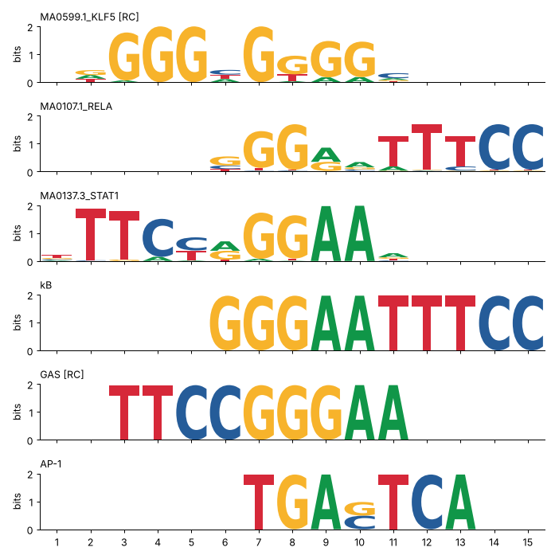
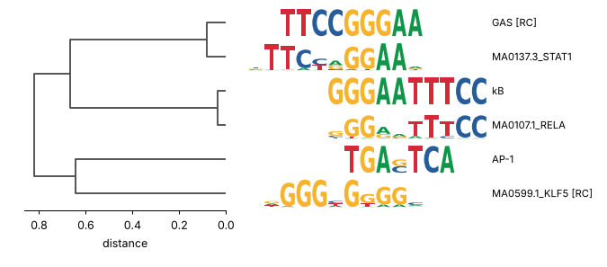

# Motif and sequence tools

moodspy ports the motif and sequence utilities of the R/Bioconductor package
[universalmotif](https://github.com/bjmt/universalmotif): information content, IUPAC
consensus, trimming, comparison, merging, clustering, logos, k-let backgrounds, shuffling,
random sequences, masking and implanting. Scanning stays with
[`match_motifs`][moodspy.match_motifs].

Where these functions turn counts into probabilities they follow universalmotif, not
motifmatchr: the pseudocount is 1 (`(n + 1/4) / (N + 1)`), and probability matrices are
used as written. Scanning keeps TFBSTools' 0.8. Every function takes `pseudocount=` if you
want one convention throughout.

## Information content, consensus, trimming

```python
import numpy as np
import pandas as pd
import moodspy as mp

motifs = mp.example_motifs()
print(mp.motif_table(motifs)[["length", "ic", "mean_ic", "consensus"]].round(2))
print(mp.motif_ic(motifs[0]).round(2))
```

```text
                length     ic  mean_ic    consensus
motif
MA0599.1_KLF5       10  12.85     1.29   GCCMCRCCCH
MA0107.1_RELA       10  12.55     1.25   GGGRATTTCC
MA0137.3_STAT1      11  14.56     1.32  NTTCYRGGAAA
[0.32 1.45 1.48 0.95 2.   0.44 2.   2.   1.78 0.43]
```

`iupac_consensus` uses universalmotif's rules: one letter when it has more than half the
probability and no other letter exceeds a quarter, a two-letter code when a pair exceeds
0.75, a three-letter code when three letters each exceed 0.25, otherwise `N`.

`trim_motifs` cuts low-information positions off the edges (0.25 bits by default):

```python
trimmed = mp.trim_motifs(motifs, min_ic=0.5)
print([(m.label, m.length) for m in trimmed])
```

```text
[('MA0599.1_KLF5', 8), ('MA0107.1_RELA', 10), ('MA0137.3_STAT1', 9)]
```

`create_motif` builds a motif from an IUPAC string, a list of sites, or at random:

```python
ap1 = mp.create_motif("TGASTCA", name="AP-1")
print(ap1, mp.iupac_consensus(ap1))
sites = mp.sample_sites(motifs[1], 5, rng=1)
print(sites)
print(mp.create_motif(sites).matrix)
```

```text
Motif('AP-1', length=7, kind='probability', consensus='TGACTCA') TGASTCA
['GTGGATTTCC', 'GGGGATTTCC', 'GGGGTTTTCC', 'GGGGCTTTCC', 'GGGAGTTTCC']
[[0. 0. 0. 1. 2. 0. 0. 0. 0. 0.]
 [0. 0. 0. 0. 1. 0. 0. 0. 5. 5.]
 [5. 4. 5. 4. 1. 0. 0. 0. 0. 0.]
 [0. 1. 0. 0. 1. 5. 5. 5. 0. 0.]]
```

## Comparing motifs

[`compare_motifs`][moodspy.compare_motifs] scores every alignment with at least
`min_overlap` columns, on both strands, and reports the best. The default is the mean
column Pearson correlation of the probability matrices:

```python
kb = mp.create_motif("GGGAATTTCC", name="kB")
stat = mp.create_motif("TTCCCGGAA", name="GAS")
pool = motifs + [kb, stat, ap1]
print(mp.compare_motifs(pool).round(2))
```

```text
                MA0599.1_KLF5  MA0107.1_RELA  MA0137.3_STAT1    kB   GAS  AP-1
motif
MA0599.1_KLF5            1.00           0.26            0.37  0.32  0.29  0.36
MA0107.1_RELA            0.26           1.00            0.64  0.97  0.49  0.21
MA0137.3_STAT1           0.37           0.64            1.00  0.72  0.92  0.21
kB                       0.32           0.97            0.72  1.00  0.33  0.20
GAS                      0.29           0.49            0.92  0.33  1.00  0.18
AP-1                     0.36           0.21            0.21  0.20  0.18  1.00
```

Twelve metrics are available (`PCC`, `WPCC`, `SW`, `ALLR`, `ALLR_LL`, `BHAT` are
similarities; `EUCL`, `WEUCL`, `SEUCL`, `MAN`, `HELL`, `KL` are distances), with seven ways
to combine column scores (`score_strat`). `targets=` compares one set against another.
Alignments whose mean information content is below `min_mean_ic` (0.25 bits) are skipped,
and a pair with no passing alignment is NaN, so filter flat motifs with `average_ic` first.

To annotate de novo motifs against a database with p-values, use
[`compare_motifs_lite`][moodspy.compare_motifs_lite]. It is the Tomtom-style path:
column PCC sums, a null distribution built from the database columns, Bonferroni over
the alignments tried and Benjamini-Hochberg over targets:

```python
denovo = mp.create_motif("NGGGAAWTYCCN", name="denovo_1")
hits = mp.compare_motifs_lite([denovo], targets=pool, qvalue=0.5)
print(hits[["target", "offset", "strand", "overlap", "score", "target_consensus", "pvalue", "qvalue"]])
```

```text
           target  offset strand  overlap     score target_consensus    pvalue    qvalue
0              kB       1      +       10  0.915470       GGGAATTTCC  0.000007  0.000043
1   MA0107.1_RELA       1      +       10  0.901705       SGGRRTTTCC  0.000027  0.000082
2  MA0137.3_STAT1      -4      +        7  0.742670          YRGGAAD  0.004314  0.008627
3             GAS       6      -        6  0.833333           TTCCCG  0.019385  0.029078
```

With a real database (e.g. all of JASPAR CORE as `targets`) the empirical null has
thousands of columns. For a handful of targets, `null="parametric"` is more stable.

## Merging and clustering

[`merge_motifs`][moodspy.merge_motifs] aligns motifs one after another and averages their
columns. [`merge_similar`][moodspy.merge_similar] clusters first (complete linkage on
`compare_motifs`) and merges within clusters, which is how to collapse a redundant
motif database:

```python
for cl in mp.merge_similar(pool, threshold=0.9, return_clusters=True):
    print([m.label for m in cl])
merged = mp.merge_similar(pool, threshold=0.9)
print([(m.name, mp.iupac_consensus(m)) for m in merged])
```

```text
['MA0599.1_KLF5']
['MA0107.1_RELA', 'kB']
['MA0137.3_STAT1', 'GAS']
['AP-1']
[('KLF5', 'GCCMCRCCCH'), ('kB/RELA', 'GGGAATTTCC'), ('GAS/STAT1', 'TTTCCCGGAAN'), ('AP-1', 'TGASTCA')]
```

[`motif_tree`][moodspy.motif_tree] returns the clustering itself. Its `clusters()` cuts the tree:

```python
tree = mp.motif_tree(pool, method="PCC")
print(tree.clusters(threshold=0.3).to_dict())
print(tree.leaves())
```

```text
{'MA0599.1_KLF5': 1, 'MA0107.1_RELA': 2, 'MA0137.3_STAT1': 3, 'kB': 2, 'GAS': 3, 'AP-1': 4}
['MA0599.1_KLF5', 'AP-1', 'MA0107.1_RELA', 'kB', 'MA0137.3_STAT1', 'GAS']
```

## Logos

The plotting functions need matplotlib (`pip install "moodspy[plot]"`).
[`plot_logo`][moodspy.plotting.plot_logo] draws one motif as information content,
probabilities or log-odds. [`view_motifs`][moodspy.plotting.view_motifs] aligns several and
stacks them, marking reverse-complemented ones `[RC]`.
[`MotifTree.plot`][moodspy.MotifTree.plot] puts aligned logos next to the dendrogram:

```py
from moodspy.plotting import plot_logo, view_motifs

plot_logo(motifs[2])
view_motifs(pool).savefig("aligned.png", dpi=150)
tree.plot().savefig("tree.png", dpi=150)
```





[`align_motifs`][moodspy.align_motifs] returns the alignment behind `view_motifs` (offset and
strand per motif, plus zero-padded matrices) for custom plots.

## Backgrounds and shuffled sequences

[`get_bkg`][moodspy.get_bkg] counts k-lets. `meme_file=` writes a MEME background model
for FIMO or MEME:

```python
seqs = mp.create_sequences(200, 300, [0.3, 0.2, 0.2, 0.3], rng=0)
bg = mp.get_bkg(seqs, k=[1, 2])
print(bg.head(6).round(4))
```

```text
  klet    count  probability
0    A  17843.0       0.2974
1    C  12131.0       0.2022
2    G  11988.0       0.1998
3    T  18038.0       0.3006
4   AA   5212.0       0.0872
5   AC   3611.0       0.0604
```

[`shuffle_sequences`][moodspy.shuffle_sequences] makes background sequences with the same
k-let composition. The default `method="euler"` keeps the counts exactly (the
Altschul-Erickson algorithm); `k=2` preserves dinucleotides, including CpG depletion:

```python
peaks = mp.create_sequences(3, 60, {a + b: (0.2 if a + b == "CG" else 1.0) for a in "ACGT" for b in "ACGT"}, rng=1)
shuffled = mp.shuffle_sequences(peaks, k=2, rng=2)
print(peaks[0], shuffled[0], sep="\n")
same = (mp.get_bkg(peaks, k=2)["count"] == mp.get_bkg(shuffled, k=2)["count"]).all()
print("dinucleotide counts identical:", same)
```

```text
GATATCCTCCATGCTCCACACTCCTTGGCATGAGTGTAGCAGTGCTGGTATGTATAATTT
GTATCAGTGTGCCTACTATGGCATGTCAGTCTTATCTGAGCCATATTTGCTGGAACCCAT
dinucleotide counts identical: True
```

## Simulated positives: implanting motifs

[`implant_motifs`][moodspy.implant_motifs] writes sampled sites into sequences and returns
where it put them, which gives ground truth for benchmarking a scan, an enrichment test
or a model. `centre_bias` concentrates implants near the middle, like peak summits:

```python
background = mp.create_sequences(100, 200, rng=3)
positives, truth = mp.implant_motifs(motifs[1], background, n_per_seq=1, centre_bias=4, rng=4)
print(truth.head(3))
hits = mp.match_motifs(motifs[1], positives, bg="even", out="positions")
found = truth.merge(hits, on=["seq", "start", "end", "strand"])
print(f"{len(found)} of {len(truth)} implants recovered at p < 5e-5")
```

```text
    seq          motif  start  end strand        site
0  seq0  MA0107.1_RELA    103  113      -  CGAAAGCCCC
1  seq1  MA0107.1_RELA    116  126      -  GGAAATCCCC
2  seq2  MA0107.1_RELA    128  138      +  GGGGATTTCC
63 of 100 implants recovered at p < 5e-5
```

A third of the implants are missed because RELA (MA0107.1) comes from only 18 sites: its
columns are broad, so many sampled sites score below the p < 5e-5 threshold. Implanted is
not the same as detectable, which is what makes this a useful benchmark.

A dinucleotide-shuffled copy of the same sequences is the usual control for motif
enrichment: it keeps GC and CpG content but destroys the sites.

```python
control = mp.shuffle_sequences(positives, k=2, rng=5)
n_pos = mp.match_motifs(motifs, positives, bg="subject", out="scores").counts.sum(axis=0)
n_ctl = mp.match_motifs(motifs, control, bg="subject", out="scores").counts.sum(axis=0)
print(pd.DataFrame({"implanted": n_pos.A1, "shuffled": n_ctl.A1}, index=[m.label for m in motifs]))
```

```text
                implanted  shuffled
MA0599.1_KLF5           3         5
MA0107.1_RELA          88         6
MA0137.3_STAT1          7         5
```

[`mask_seqs`][moodspy.mask_seqs] and [`mask_ranges`][moodspy.mask_ranges] blank out a
pattern or given ranges (default letter `N`, which never matches), e.g. to remove known
sites before searching for secondary motifs:

```python
masked = mp.mask_ranges(positives, truth)
print(positives[0][truth.start[0] - 3 : truth.end[0] + 3])
print(masked[0][truth.start[0] - 3 : truth.end[0] + 3])
```

```text
CGTCGAAAGCCCCCCA
CGTNNNNNNNNNNCCA
```

## Coming from universalmotif

| universalmotif | moodspy |
|---|---|
| `convert_type(m, "ICM")`, `average_ic()` | `icm(m)`, `motif_ic(m)`, `average_ic(motifs)` |
| `m["consensus"]`, `get_consensus()` | `iupac_consensus(m)` |
| `trim_motifs(motifs, min.ic, trim.from)` | `trim_motifs(motifs, min_ic=, trim_from=)` |
| `create_motif("TGASTCA")`, `create_motif(sites)` | `create_motif("TGASTCA")`, `create_motif(sites)` |
| `shuffle_motifs()`, `sample_sites()`, `round_motif()`, `score_match()` | same names |
| `summarise_motifs()` / `to_df()` | `motif_table(motifs)` |
| `compare_motifs(motifs, method, tryRC, min.overlap, ...)` | `compare_motifs(motifs, method=, try_rc=, min_overlap=, ...)` |
| `compare_motifs(motifs, compare.to = 1:3)` | `compare_motifs(motifs[:3], targets=motifs)` (scores only) |
| `compare_motifs_lite(c(q, db), compare.to = 1)` | `compare_motifs_lite([q], targets=[q] + db)` |
| `merge_motifs()`, `merge_similar()` | same names |
| `motif_tree()` (ggtree plot) | `motif_tree()` (SciPy linkage) and `.plot()` |
| `view_motifs()`, `view_logo()` | `plotting.view_motifs()`, `plotting.plot_logo()` |
| `get_bkg(seqs, k, RC, to.meme)` | `get_bkg(seqs, k=, rc=, meme_file=)` |
| `shuffle_sequences(seqs, k, method)` | `shuffle_sequences(seqs, k=, method=, rng=)` |
| `create_sequences(seqnum, seqlen, freqs)` | `create_sequences(n, length, freqs)` |
| `mask_seqs()`, `mask_ranges(GRanges)` | `mask_seqs()`, `mask_ranges(DataFrame)` |
| `implant_motifs(..., return.indices = TRUE)` | `implant_motifs(...)` returns `(sequences, table)` |
| `rng.seed = 123` | `rng=123` or a `numpy.random.Generator` |
| 1-based positions | 0-based, half-open |

What is the same: the scores. `compare_motifs` (all 12 metrics and 7 score strategies,
overlap, IC filters, normalisation), `compare_motifs_lite` (scores, p- and q-values,
offsets, consensus strings), `merge_motifs`, `merge_similar` clusters, information
content, consensus, trimming and `get_bkg` reproduce universalmotif 1.31 to 1e-6; the
fixtures are in `tests/data/` and the generating R script is
`tests/data/make_universalmotif_fixtures.R`.

What differs:

- universalmotif tops up count columns that sum to less than `nsites` (adding the
  difference to the largest count) when it reads a file; moodspy keeps the counts as
  they are. Different-depth columns give slightly different probabilities.
- `merge_motifs` and the alignment step pick the reverse complement when it is *better*
  for distance metrics too; universalmotif compares `score_rc > score` regardless of the
  metric's direction, which takes the worse strand for `EUCL` & co.
- `align_motifs`/`view_motifs` align probability matrices; universalmotif's
  `view_motifs` aligns the displayed matrix (ICM by default).
- `compare_motifs` with `targets=` gives scores, not universalmotif's p-values from its
  precomputed JASPAR2018 score distributions. Use `compare_motifs_lite` for p-values.
- universalmotif keeps the background letter frequencies of a MEME file with each motif
  and uses them in `ALLR`, `WPCC`, `WEUCL` and relative-entropy IC; moodspy motifs read
  from MEME files have a uniform background.
- Random functions use NumPy generators, so the same seed gives different sequences than R.
- `mask_seqs` masks with `N`, not `-`.
